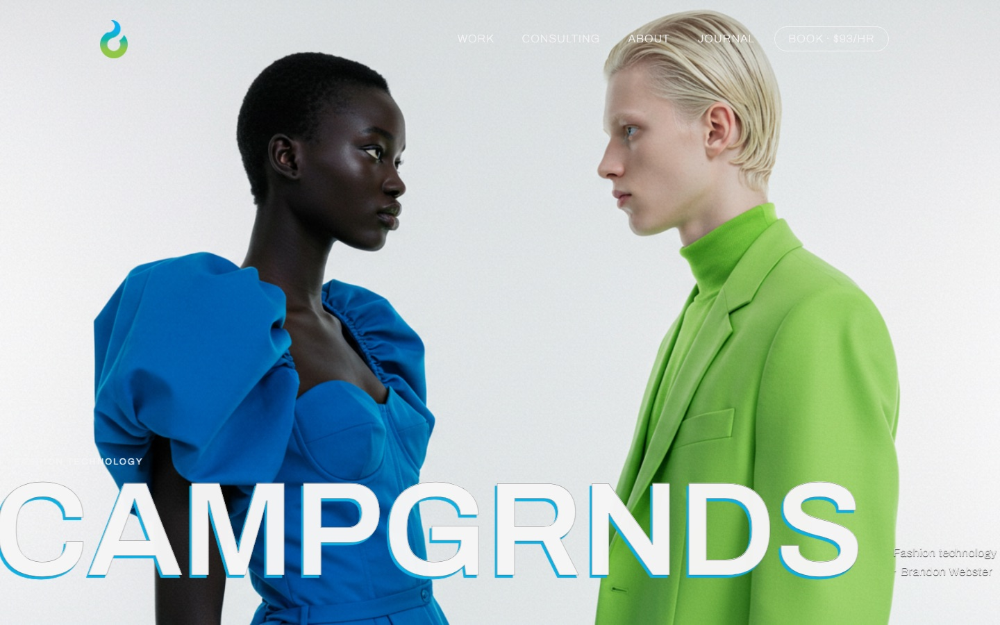
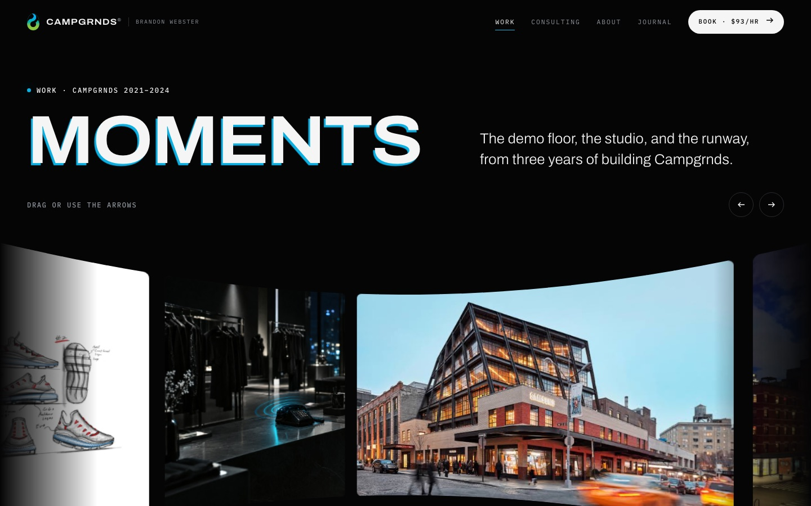

# campgrnds.com

**Live: https://campgrnds.com**

The portfolio site for Campgrnds, the fashion-technology studio I ran from 2021 to 2024. It has case studies
on AI voice agents, digital product passports and NFC, a journal, and my 1:1 consulting.





## What I built

- **A static site with no framework.** Hand-written HTML and CSS, with dependency-free JavaScript on the inner pages.
  It loads fast and stays readable with JS turned off.
- **`motion.js`**: an animation layer where every effect is opt-in through a `data-` attribute (split-text reveals,
  scroll-in, image frames). It honors `prefers-reduced-motion`.
- **`tilted-grid.js`**: the curved image reel on the Work and About pages. Images stream around the inside of a cylinder.
  Video items draw slices of one shared hidden `<video>` onto canvases, so a clip plays across the bend.
  Drag, arrow keys and buttons all work, and the plain `` list is the screen-reader and no-JS version.
- **`glyph-swell.js`**: a canvas grid of monospaced glyphs behind the menu that swells in rings from the pointer.
  It only animates while the menu is open.
- Both effects started as React components; I rewrote them as plain JavaScript so the site has no build step.
- **Home page**: designed in Webflow, then exported and moved off Webflow hosting. I replaced its collapsed nav with the
  site-wide menu (`assets/landing/css/menu.css`, `assets/landing/js/menu.js`).
- **Media pipeline**: image and video slots are `<figure class="hf" data-hf="ID">` placeholders. Dropping
  `assets/hf/ID.jpg` or `.mp4` into place fills them, so art can change without touching page markup.

**Stack:** HTML, CSS, vanilla JavaScript, Canvas 2D, Webflow (home page export), AI-generated imagery (Higgsfield),
static hosting on here.now with a custom domain

## Layout

```
publish/            the site exactly as deployed (source of truth)
  *.html            one file per page; folder stubs redirect old Webflow URLs
  assets/css        site.css
  assets/js         motion.js, tilted-grid.js, glyph-swell.js
  assets/landing    Webflow export for the home page (+ menu.css / menu.js)
  assets/img, hf    images and video
landing-src/        readable copies of the Webflow home page markup
```

## Run it locally

```sh
cd publish && python3 -m http.server 8000   # then open http://localhost:8000
```

## Deploy

Published with the [here.now](https://here.now) skill, from the repo root:

```sh
~/.claude/skills/here-now/scripts/publish.sh publish --slug inner-gazebo-43th --client claude-code
```

## License

The code is here to read. The words, photos, video and brand assets are © Brandon Webster / Campgrnds, all rights reserved.
See `LICENSE`.
